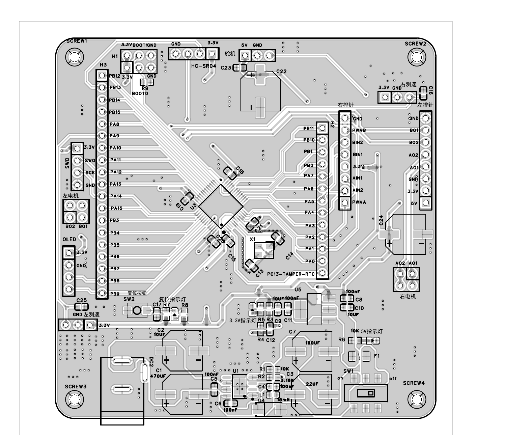
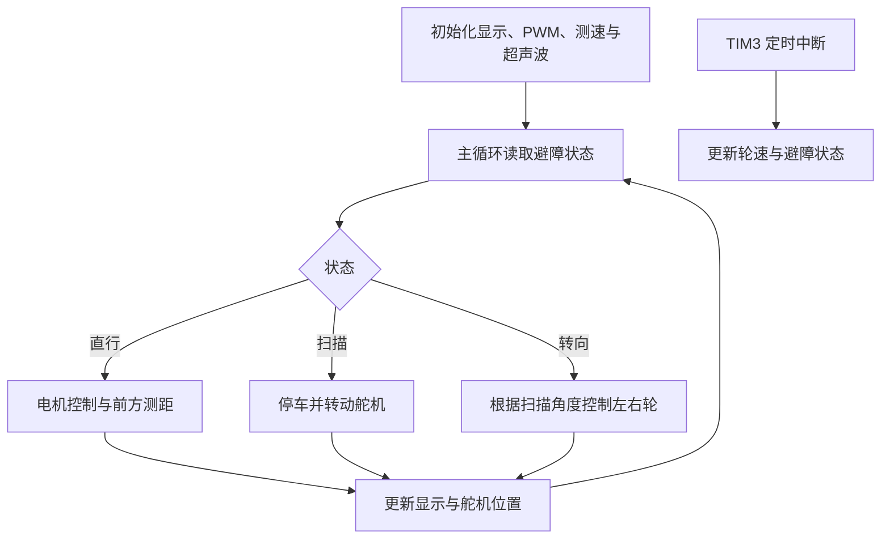

# STM32F103 超声波避障小车

基于 **STM32F103C8T6、HC-SR04 与电机驱动**的个人学习项目，包含 C 固件、两层 PCB 的硬件导出资料，以及 Keil 工程。

通过超声波测距、舵机扫描和双轮控制，探索小车的直行、停车、扫描与转向流程。源码已按模块展开，可以直接在 GitHub 浏览。

**快速入口：** [主程序](firmware/User/main.c) · [避障逻辑](firmware/Application/APP_Obstacle_Avoidance.c) · [电机 PID](firmware/Algorithm/MotorPID.c) · [原理图](hardware/schematic/schematic.pdf) · [PCB](hardware/pcb/pcb-layout.pdf) · [构建说明](docs/build.md)

## 硬件预览



预览来自 PCB PDF 第 5 页；完整文件和制造资料在 [hardware](hardware/README.md)。

## 工程内容

| 部分 | 内容 |
| --- | --- |
| 主控 | STM32F103C8T6，Cortex-M3 |
| 开发环境 | C、Keil MDK/uVision、ARM Compiler 5、STM32F10x 标准外设库 |
| 避障感知 | HC-SR04，TIM1 输入捕获 |
| 运动控制 | 电机 PWM、轮速采样、PID 与滤波模块 |
| 扫描与显示 | 舵机扫描、OLED 状态显示 |
| 硬件资料 | 原理图 PDF、PCB PDF、BOM、Gerber |

## 目录

```text
.
├── firmware/
│   ├── Application/             # 避障与动作控制
│   ├── Algorithm/               # PID、滤波、排序
│   ├── HAL/                     # 项目自定义硬件抽象封装
│   ├── Hardware/                # 电机、超声波、测速、OLED 等驱动
│   ├── System/                  # 延时与定时器
│   ├── User/                    # main.c 与中断配置
│   ├── Libraries/               # CMSIS 与 STM32 标准外设库
│   └── projects.uvprojx         # Keil 工程入口
├── hardware/                    # 原理图、PCB、BOM、Gerber
├── docs/                        # 构建、接线、整理说明及待验证项
├── scripts/verify_repository.py # 工程路径与资料完整性检查
└── archive/                     # 原始压缩包备份
```

`HAL/` 是本项目自己的封装层，不是 STM32Cube HAL；固件使用 STM32F10x 标准外设库。

## 软件流程



入口是 [main.c](firmware/User/main.c)。图示依据当前代码中的状态分支整理；算法与硬件时序仍有 [待验证项](docs/known-issues.md)。

## 打开与检查

1. 克隆仓库：

   ```bash
   git clone https://github.com/shuiqiling/-stm32f103C8T6-PCB-.git
   ```

2. 用 Keil MDK 打开 [`firmware/projects.uvprojx`](firmware/projects.uvprojx)。工具链、器件包和烧录步骤见 [构建说明](docs/build.md)。
3. 使用 Python 3.9 或更新版本检查仓库结构：

   ```bash
   python scripts/verify_repository.py
   ```

此检查验证工程引用、头文件路径、文档链接及硬件文件完整性；实际编译和上车验证应在配置好 ARM 工具链及硬件后进行。

## 资料与维护

- [硬件资料说明](hardware/README.md)
- [代码引脚与硬件核对](docs/hardware.md)
- [原始压缩包与目录迁移说明](docs/archive.md)
- [后续复测事项](docs/known-issues.md)
- [第三方代码说明](THIRD_PARTY.md)

本仓库保留原始提交历史与压缩包。应用控制逻辑按原工程保留，本次整理包含目录迁移、编码/换行统一、工程相对路径修正，以及目标芯片宏的显式配置。
