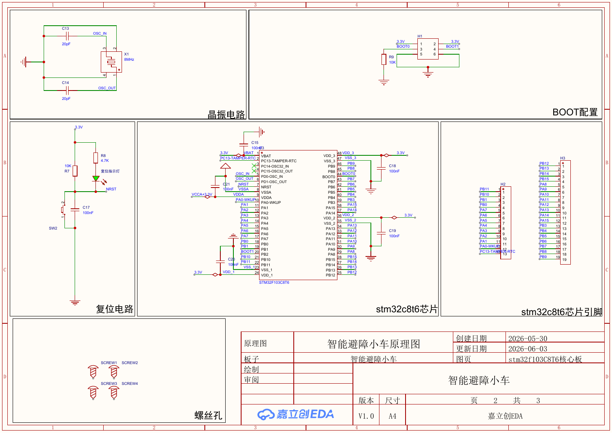

# 硬件资料

以下文件从原始压缩包的“立创eda”目录整理而来，文件内容保持原样。

| 资料 | 路径 | 说明 |
| --- | --- | --- |
| 原理图 | [schematic/schematic.pdf](schematic/schematic.pdf) | 3 页，含电源、主控及外设接口 |
| PCB 导出 | [pcb/pcb-layout.pdf](pcb/pcb-layout.pdf) | 7 页，包含布局、器件表及布线导出页 |
| BOM | [bom/bom.xlsx](bom/bom.xlsx) | 原始物料清单 |
| Gerber | [gerber/board-gerber.zip](gerber/board-gerber.zip) | 制造资料压缩包，按原样保留 |

上图来自原理图 PDF 第 2 页。Gerber 是制造交付文件，保留压缩格式便于提交给板厂；软件源码已在 `firmware/` 展开。

当前原始包只提供上述导出资料，没有找到嘉立创 EDA 可编辑工程文件。后续若补充工程源文件，可放入 `hardware/source/` 并注明对应版本。

原始文件名和 SHA256 对照见 [导入清单](../docs/import-manifest.json)。代码引脚分配见 [硬件核对说明](../docs/hardware.md)。
